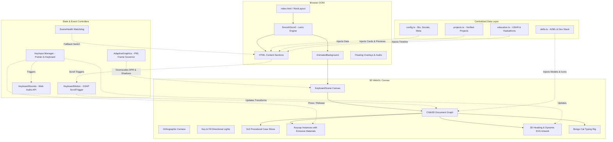

# Target Architecture: Mayank Dabas Personalized 3D Portfolio

**Project:** Mayank Dabas — Interactive 3D Developer Portfolio  
**Target Architecture:** Next.js 16 App Router + React 19 + Chibi3D / Three.js + GSAP ScrollTrigger  
**Document Date:** October 2026  
**Auditor:** Antigravity Engineering

---

## 1. Architectural Philosophy & Principles

1. **Engineering Transparency:** Every 3D interaction, camera motion, and shader parameter is mathematically deliberate and inspectable. No magical black boxes.
2. **Authenticity First:** Zero fabricated metrics, fake clients, or imaginary employment. Every project, badge, and skill is backed by Mayank Dabas's verified academic and technical work (USAR GGSIPU, SUTRAM 2026, SIH 2026, Paytm Build for India).
3. **Progressive Enhancement & Resilient 3D:** The portfolio must function flawlessly on an RTX 4090 workstation, an iPhone 13 in Low Power Mode, and a university library computer with WebGL disabled. If 3D is unavailable, an accessible, beautifully styled HTML fallback seamlessly presents the full experience.
4. **Separation of Content and Presentation:** 100% of personal data, projects, educational milestones, and skill metadata is isolated in strictly typed configuration modules (`src/data/`). Components remain purely functional and reusable.

---

## 2. Framework & Runtime Selection

### Why Next.js 16 (App Router) + React 19?
We evaluated two architectural approaches:
- **Approach A: Vite + React 19 SPA**
- **Approach B: Next.js 16 App Router + React 19 (Recommended)**

| Architectural Consideration | Vite SPA | Next.js App Router (Selected) | Rationale |
| :--- | :--- | :--- | :--- |
| **`@chibi3d/runtime` Compatibility** | Requires manual bundle shim and asset loader overrides. | Native first-class support; designed specifically for Next.js App Router with `dynamic(..., { ssr: false })`. | Eliminates subtle WebGL asset loader crashes. |
| **SEO & Social OpenGraph** | Client-side only; requires pre-render plugins or headless crawlers fail to see meta tags. | Server-rendered `Metadata` API generates static OpenGraph, Twitter cards, and JSON-LD for every bot. | Essential for personal branding and search indexing. |
| **Typography Performance** | External Google Fonts stylesheet (render-blocking network requests). | `next/font` automatically inlines font sub-sets at build time with zero layout shift (`display: "swap"`). | Flawless typography loading without FOUT (Flash of Unstyled Text). |
| **Deployment Flexibility** | Static dist folder. | Static export (`output: "export"`) or standard Node.js serverless deployment on Vercel / GitHub Pages. | Zero hosting lock-in while preserving serverless API route capabilities (e.g. contact form). |

**Conclusion:** We adopt Next.js 16 App Router with React 19 and TypeScript 5, matching the reference's proven stack while modernizing the component architecture.

---

## 3. System Architecture & Component Diagram



---

## 4. Directory & Module Structure

```
d:/Projects/Portfolio/
├── public/
│   ├── assets/
│   │   ├── keyboard/
│   │   │   ├── keycaps.glb          # 204KB 3x3 procedural case + sculpted cap
│   │   │   ├── bongo-frames.glb      # 28KB animated cat typing model
│   │   │   └── logos/                # Skill SVG brand marks
│   │   ├── keycap-sounds/
│   │   │   ├── press.mp3             # Mechanical switch downstroke sound
│   │   │   └── release.mp3           # Mechanical switch upstroke sound
│   │   └── projects/
│   │       ├── forensic_x_dashboard.png   # Verified SUTRAM 2026 screenshot
│   │       ├── suraksha_architecture.png  # Verified Paytm Hackathon screenshot
│   │       ├── redzone_erosion.png        # Verified SIH 2026 screenshot
│   │       ├── eventtwin_zonemap.png      # Verified EventTwin screenshot
│   │       └── stivium_logo.svg           # Verified Stivium IDE vector mark
├── docs/
│   ├── REFERENCE_ANALYSIS.md         # Reverse-engineering teardown
│   ├── FEATURE_MATRIX.md             # Feature decisions & licensing
│   ├── ARCHITECTURE.md               # This document
│   ├── IMPLEMENTATION_PLAN.md        # Staged implementation roadmap
│   └── LEARNING_GUIDE.md             # Theoretical & practical study guide
├── src/
│   ├── app/
│   │   ├── layout.tsx                # Fonts, theme providers, root metadata
│   │   ├── page.tsx                  # Scroll container mounting all sections
│   │   └── globals.css               # Design tokens, CSS variables, utility classes
│   ├── components/
│   │   ├── keyboard/
│   │   │   ├── keyboard-scene.tsx    # Chibi3D Canvas mounting & lifecycle
│   │   │   ├── scene.ts              # Procedural 3x3 case generation & scene graph
│   │   │   ├── motion.ts             # GSAP ScrollTrigger timeline orchestration
│   │   │   ├── input.ts              # Pointer raycasting & QWERTY keyboard listeners
│   │   │   ├── adaptive-graphics.ts  # Frame rate sampling & quality tier governor
│   │   │   ├── use-adaptive-graphics.ts
│   │   │   ├── use-keyboard-sounds.ts# Web Audio API sound synthesizers
│   │   │   └── heading-metrics.json  # Precomputed font glyph bounding metrics
│   │   ├── sections/
│   │   │   ├── hero.tsx              # High-impact typography hero section
│   │   │   ├── skills.tsx            # Dual 3D + Accessible HTML skill grid
│   │   │   ├── projects.tsx          # Verified project showcases with scrolling preview
│   │   │   ├── experience.tsx        # Education, Hackathon & Leadership journey
│   │   │   └── contact.tsx           # Contact form with validation & mailto fallback
│   │   ├── ui/
│   │   │   ├── button.tsx
│   │   │   ├── responsive-dialog.tsx # Vaul drawer on mobile / Radix on desktop
│   │   │   ├── scrolling-preview.tsx # Parallax preview card for project screenshots
│   │   │   └── section-header.tsx
│   │   ├── animated-background.tsx   # Dynamic scene boundary & WebGL context monitor
│   │   ├── Particles.tsx             # 2D canvas particle depth layer
│   │   ├── smooth-scroll.tsx         # Lenis smooth-scroll provider
│   │   └── site-frame.tsx            # Header, footer, and overlay wrapper
│   ├── data/
│   │   ├── config.ts                 # Personal metadata (Mayank Dabas, USAR, GitHub)
│   │   ├── constants.ts              # Skills mapping, brand colors, shortcuts
│   │   ├── projects.ts               # Verified project descriptions, links & assets
│   │   └── education.ts              # Academic degrees, hackathon finalist milestones
│   └── lib/
│       ├── scene-health.ts           # Global scene loading state & error bus
│       └── utils.ts                  # Tailwind clsx/twMerge utility
```

---

## 5. Subsystem Specifications

### 5.1 Interactive 3D Keyboard Engine
- **Procedural 3x3 Slicing:** Dynamically recalculates outer box dimensions based on skill count ($N$) and column count ($C$).
  $$\text{cols} = \min(C, N), \quad \text{rows} = \lceil N / \text{cols} \rceil$$
  $$\text{innerX} = \text{cutX} + (\text{cols} - 6) \cdot \frac{\text{pitch}}{2}$$
  $$\text{innerZ} = \text{cutZ} + (\text{rows} - 4) \cdot \frac{\text{pitch}}{2}$$
- **Keycap Materials:** Standard PBR with `roughness: 0.34`, `clearcoat: 0.12`, `clearcoatRoughness: 0.38`. When pressed, `emissive` triggers with intensity `0.7`.
- **Dynamic Text Display:** 
  - Extruded 3D title mesh (`kind: "text3d"`) above keyboard.
  - Multi-line description rendered as SVG vector string in a Data URI, loaded onto a plane texture.

### 5.2 Motion & Scroll Coordination
- **GSAP ScrollTrigger:** Virtual scroll heights create generous interaction zones.
  - Hero: Isometric floating idle animation with `back.inOut` yoyo easing.
  - Skills: Rotates to face user directly (15° yaw on desktop, 30° on mobile), displays skill labels, accepts key clicks.
  - Projects: Flips upside-down; renders Bongo Cat typing in alternating frames.
  - Contact: Exploded-view elastic disassembly where keycaps float in staggered waves.

### 5.3 Centralized Personal Data Specification
All Mayank Dabas details will be typed and exported from `src/data/`:
- **Bio & Identity:** First-year B.Tech + M.Tech AI/ML student at University School of Automation & Robotics (USAR), GGSIPU, Delhi.
- **Projects:**
  1. **FORENSIC-X (SUTRAM 2026 Finalist):** Comprehensive digital forensics and incident response platform.
  2. **Suraksha Sense (Paytm Hackathon Finalist):** AI-powered real-time surveillance and incident detection engine.
  3. **Stivium IDE:** Experimental lightweight IDE built with Rust and Tauri (collaborative project with Aditya Bhatnagar).
  4. **REDZONE (SIH 2026):** Geological landslide and seismic hazard prediction system.
  5. **EventTwin (SIH 2026):** Spatial crowd simulation and safety digital twin.
  6. **Disease Prediction System:** Python & MySQL machine learning diagnostic tool.

---

## 6. Accessibility, SEO & Quality Assurance

1. **Screen Reader Parity:** 
   - An off-screen `div` with `aria-live="polite"` announces active skill labels and descriptions as keys are activated.
   - The `<SkillsSection>` maintains an accessible HTML `<ul>` list in the DOM with semantic headings and tags.
2. **Reduced Motion:** If `prefers-reduced-motion: reduce` is active:
   - 3D idle spins and elastic disassembly are disabled.
   - Lenis smooth scrolling switches to standard browser scroll.
3. **Audio Controls:**
   - Sound defaults to enabled with mechanical feedback, but includes an instant mute toggle in the site header.
4. **Search Engine Optimization (SEO):**
   - Single canonical `<h1>` tag per page.
   - Structured metadata (OpenGraph preview, Twitter cards, JSON-LD developer schema).
   - Fast Core Web Vitals (LCP < 1.8s, CLS < 0.05).
