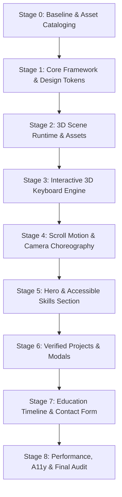

# Staged Implementation Plan: Mayank Dabas 3D Portfolio

**Target Application:** Personalized Interactive 3D Developer Portfolio  
**Reference Model:** [Naresh-Khatri/3d-portfolio](https://github.com/Naresh-Khatri/3d-portfolio)  
**Date:** October 2026  
**Auditor:** Antigravity Engineering

---

## 1. Implementation Philosophy

To ensure reliability, transparency, and high engineering quality:
1. **Incremental Staging:** Implementation proceeds in logical, reviewable phases. Each stage concludes with automated validation and visual browser testing.
2. **Zero Big-Bang Rewrites:** Code is committed and verified stage-by-stage so changes are understandable and fully reversible.
3. **No Fabricated Data:** Only verified information regarding Mayank Dabas's education, projects, skills, and hackathon accomplishments is used.
4. **Resilience & Testing:** Static typechecks (`tsc`), linting (`eslint`), and interactive browser inspections occur at every checkpoint.

---

## 2. Staged Roadmap & Execution Sequence

---

### Stage 0 — Workspace Baseline & Asset Cataloging
- **Goal:** Verify the current repository state, preserve existing project screenshots, and catalog all required 3D/audio assets.
- **Files Created / Preserved:**
  - Preserved: `public/assets/projects/` (`forensic_x_*.png`, `suraksha_*.png`, `redzone_*.png`, `eventtwin_*.png`, `stivium_logo.svg`).
  - Cataloged: `keycaps.glb`, `bongo-frames.glb`, `press.mp3`, `release.mp3`, SVG logos.
- **Acceptance Criteria:**
  - Workspace Git tree is clean.
  - All verified project screenshots are intact in `public/assets/projects/`.
  - Required 3D geometry and sound assets are copied to `public/assets/`.
- **Testing:** `git status`, file integrity check on all assets.

---

### Stage 1 — Core Framework, Dependencies & Design System
- **Goal:** Set up Next.js 16 App Router with React 19, Tailwind CSS 3.4, and the complete design token system (Space Grotesk + Unbounded fonts, dark/light theme variables).
- **Files Created / Changed:**
  - `package.json`: Configure Next.js, React 19, `@chibi3d/runtime`, `three`, `gsap`, `lenis`, `motion`, `vaul`, Radix UI.
  - `src/app/layout.tsx`: Root layout with font bindings (`--font-sans`, `--font-display`), theme provider, and SEO metadata.
  - `src/app/globals.css`: Dark/light theme HSL color tokens, typography scales, edge outline styles.
  - `src/lib/utils.ts`: Standard `cn` helper (`clsx` + `tailwind-merge`).
  - `src/data/config.ts`: Mayank Dabas personal metadata configuration.
- **Acceptance Criteria:**
  - `npm install` finishes with zero dependency conflicts.
  - `npm run dev` boots successfully without compilation warnings.
  - Google Fonts (Space Grotesk & Unbounded) render without FOUT.
- **Testing:** `npm run typecheck`, browser navigation to `http://localhost:3000`.

---

### Stage 2 — 3D Scene Core & Asset Pipeline
- **Goal:** Mount the `@chibi3d/runtime` canvas behind the DOM, initialize WebGL context detection, and configure the asset resolution pipeline.
- **Files Created / Changed:**
  - `src/components/animated-background.tsx`: Dynamic import of keyboard scene with SSR disabled, WebGL context loss watchdog, and fallback error boundary.
  - `src/lib/scene-health.ts`: Global reactive scene health store (`loading`, `ready`, `failed`).
  - `src/components/keyboard/adaptive-graphics.ts`: 4-tier graphics settings (`ultra`, `high`, `medium`, `low`).
  - `src/components/keyboard/use-adaptive-graphics.ts`: 95th percentile ($P_{95}$) frame rate monitor.
- **Acceptance Criteria:**
  - Full-screen WebGL canvas mounts behind the viewport.
  - If WebGL is simulated as disabled, the error boundary gracefully fires without crashing React.
  - Scene health transitions from `loading` to `ready`.
- **Testing:** Browser DevTools WebGL inspection, simulate context loss.

---

### Stage 3 — Interactive 3D Keyboard Engine
- **Goal:** Generate the procedural 3x3 segmented keyboard case, populate keycaps from Mayank's verified skillset, bind Web Audio mechanical switch sounds, and enable pointer/keyboard input.
- **Files Created / Changed:**
  - `src/components/keyboard/scene.ts`: Procedural box-slicing math, PBR materials, 3D extruded title generation, dynamic SVG description texture rasterization.
  - `src/components/keyboard/input.ts`: Multi-source input manager tracking hover, click, and QWERTY keyboard shortcuts.
  - `src/components/keyboard/use-keyboard-sounds.ts`: Low-latency Web Audio sound triggers for press and release.
  - `src/components/keyboard/heading-metrics.json`: Precomputed font glyph width tables.
  - `src/data/constants.ts`: Complete skill taxonomy with brand colors, SVGs, and keyboard shortcuts.
- **Acceptance Criteria:**
  - Keyboard renders with sharp, undistorted corner bevels.
  - Clicking or typing a key triggers physical downward translation (`-KIT.keyHeight * 0.6`) and glowing emissive color.
  - Mechanical switch click sound plays crisply.
  - Extruded 3D title and crisp SVG subtitle update instantly above the keyboard.
- **Testing:** Interactive click & keyboard testing in browser; verify sound plays without clipping.

---

### Stage 4 — Scroll Motion & Camera Choreography
- **Goal:** Bind GSAP `ScrollTrigger` and `lenis` smooth scrolling to keyboard transformations across all sections.
- **Files Created / Changed:**
  - `src/components/keyboard/motion.ts`: Quaternion-based camera and group transformations for Hero, Skills, Projects, and Contact sections.
  - `src/components/smooth-scroll.tsx`: Lenis virtual scroll wrapper synchronized with GSAP tick loop.
  - `src/app/page.tsx`: Section scaffold with virtual heights (`#hero`, `#skills`, `#projects`, `#contact`).
- **Acceptance Criteria:**
  - Hero: Keyboard rotates continuously in an idle back-and-forth floating motion.
  - Skills: Keyboard tilts upright to face viewer directly; 3D labels become visible.
  - Projects: Keyboard flips upside-down; Bongo Cat appears typing in a 2-frame loop.
  - Contact: Keyboard tilts sideways; keycaps execute a staggered elastic wave.
  - Scrolling up reverses all animations seamlessly without sudden snapping.
- **Testing:** Smooth scroll evaluation from top to bottom; check frame rates in DevTools Performance panel.

---

### Stage 5 — Hero Section & Accessible Skills Fallback
- **Goal:** Build Mayank's personalized hero header with high-impact typography, atmospheric particle background, and the accessible HTML skills grid mirror.
- **Files Created / Changed:**
  - `src/components/sections/hero.tsx`: Personalized title ("Mayank Dabas"), subtitle ("AI/ML Engineer & Creative Technologist"), resume link, GitHub/LinkedIn buttons.
  - `src/components/sections/skills.tsx`: Dual-mode skills section (3D viewport + accessible HTML grid with glowing hover cards).
  - `src/components/Particles.tsx`: 2D canvas starfield / ambient particles with mouse repulsion.
- **Acceptance Criteria:**
  - Hero matches the visual aesthetic and polish of the reference site.
  - Skills section maintains an accessible `<ul>` in the DOM with `aria-live="polite"` mirror.
  - Background particles react subtly to pointer proximity.
- **Testing:** Visual design inspection, screen reader testing, responsive layout checks on mobile and tablet.

---

### Stage 6 — Verified Projects Section & Interactive Modals
- **Goal:** Implement the project showcase featuring Mayank's verified projects with parallax scrolling previews and responsive modal dialogs.
- **Files Created / Changed:**
  - `src/data/projects.ts`: Authentic data, tech tags, and descriptions for FORENSIC-X, Suraksha Sense, Stivium IDE, REDZONE, EventTwin, and Disease Prediction System.
  - `src/components/sections/projects.tsx`: 3-column project card grid.
  - `src/components/scrolling-preview.tsx`: Hover-activated vertical pan of verified project screenshots.
  - `src/components/ui/responsive-dialog.tsx`: Desktop Radix modal dialog and mobile Vaul drawer.
- **Acceptance Criteria:**
  - Hovering a card smoothly scrolls the full screenshot.
  - Clicking a card opens the responsive modal displaying tech stack tags, architecture breakdown, and verified links.
  - No broken images, missing links, or unverified claims.
- **Testing:** Open every project dialog in both mobile and desktop viewports; verify link destinations.

---

### Stage 7 — Education Timeline, Contact Form & Polish
- **Goal:** Implement Mayank's authentic education and hackathon journey, functional contact form, theme switcher, and audio mute control.
- **Files Created / Changed:**
  - `src/data/education.ts`: Verified academic milestones (USAR GGSIPU AI/ML) and hackathon achievements.
  - `src/components/sections/experience.tsx`: Timeline component with badges and expandable milestones.
  - `src/components/sections/contact.tsx`: Validated contact form with direct mailto fallback and social links.
  - `src/components/header/header.tsx`: Navigation bar with theme toggle, audio mute/unmute switch, and GitHub star counter.
  - `src/components/footer/footer.tsx`: Minimalist footer with copyright, tech stack credits, and MIT attribution.
- **Acceptance Criteria:**
  - Education cards clearly highlight USAR, SUTRAM 2026, and Paytm Hackathon achievements.
  - Contact form validates email input and provides immediate user feedback.
  - Audio mute switch immediately mutes all keycap click sounds.
- **Testing:** Test theme switching (dark/light), form submission flow, audio mute toggle.

---

### Stage 8 — Performance, Accessibility & Final Audit
- **Goal:** Run comprehensive end-to-end audits across performance, responsiveness, accessibility, and cross-browser stability.
- **Tasks & Verifications:**
  - Production build execution (`npm run build`).
  - TypeScript validation (`npm run typecheck`).
  - Adaptive graphics governor stress test (verify automatic tier reduction under GPU load).
  - Reduced-motion accessibility verification (`prefers-reduced-motion`).
  - Mobile responsiveness verification (iPhone, Android, tablet viewports).
- **Acceptance Criteria:**
  - Zero build errors, zero TypeScript errors, zero console errors.
  - 60 FPS scroll performance on modern hardware; smooth degradation on low-power mode.
  - Full keyboard accessibility and WCAG AA contrast compliance.

---

## 3. Risk Assessment & Mitigation Strategies

| Risk | Likelihood | Impact | Architectural Mitigation |
| :--- | :--- | :--- | :--- |
| **WebGL Context Loss on Mobile** | Medium | High | `SceneErrorBoundary` and context watchdog automatically switch to the accessible HTML skill grid without page reload. |
| **High GPU / Battery Drain** | Medium | Medium | `useAdaptiveGraphics` idles rendering when inactive; automatically caps DPR and disables expensive shadows if frame times exceed 18ms. |
| **Scroll Desynchronization (Jank)** | Low | High | Synchronizing Lenis virtual scroll with GSAP's internal ticker eliminates race conditions and ensures locked 60 FPS interpolation. |
| **Third-Party Email API Failure** | Low | Low | Contact form uses client-side validation and graceful fallback to pre-formatted `mailto:` link if backend delivery fails. |
| **Information Fabrication** | Low | Critical | Strict rule: All text in `src/data/` is sourced strictly from verified repositories and user-confirmed academic credentials. |
