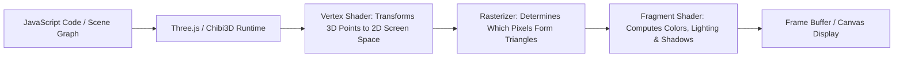
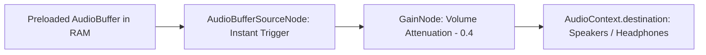

# Engineering Learning Guide: Interactive 3D Web Development

**Project:** Mayank Dabas — Interactive 3D Developer Portfolio  
**Audience:** Mayank Dabas (AI/ML Undergraduate, USAR GGSIPU)  
**Date:** October 2026  
**Author:** Antigravity Engineering

---

## Welcome to the Engineering Teardown

This guide is designed to explain the computer graphics, mathematics, and software architecture behind this 3D portfolio. Rather than treating 3D web development as a mysterious black box, this document breaks down each foundational concept so you can understand, modify, and build upon the codebase yourself.

---

## 1. WebGL & Scene Graphs: From Numbers to Pixels

### How Browsers Render 3D
Every 3D experience in a web browser runs through **WebGL** (or WebGPU), a JavaScript API that talks directly to the computer's Graphics Processing Unit (GPU).



### The Scene Graph Hierarchy
3D scenes are organized as **directed acyclic graphs (trees)** called scene graphs:
- If a parent group moves or rotates, all child meshes move with it.
- In our keyboard scene (`scene.ts`), the structure is composed of decoupled layers:
  1. `Keyboard placement` (Global world coordinates: moves between sections).
  2. `Keyboard reveal` (Scale spring for the initial page load pop-in).
  3. `Keyboard rotation` (Continuous idle Y-axis yaw).
  4. `Keyboard layout` (Positions the procedural case and center offset).
  5. `Slot [SkillName]` (Calculates the grid slot coordinate: $X, Z$).
  6. `Motion [SkillName]` (Local Y translation for elastic float animations).
  7. `Keycap Mesh [SkillName]` (Physical downward press translation: $-KIT.keyHeight \cdot 0.6$).

**Key Insight:** By separating transforms into nested parent-child groups, animations do not fight or overwrite each other. The idle spin, scroll translation, floating wave, and individual keypress can all occur simultaneously without complex arithmetic conflicts.

---

## 2. Procedural Geometry: 9-Slice 3D Box Scaling

### The Problem
If you have a 3D model of a keyboard designed for 24 keys, and you simply scale it using `scale.x = 1.5` to fit 36 keys, the corner bevels, screw holes, and side chamfers will stretch and distort into ugly ellipses.

### The Solution: 3D 9-Slicing (Procedural Mesh Decomposition)
In 2D web design, CSS provides `border-image-slice` to scale button backgrounds without distorting rounded corners. Our keyboard uses the exact same mathematical principle in 3D:

The keyboard model (`keycaps.glb`) breaks the outer case into 9 discrete mesh pieces:
```
[1: Corner Top-Left]     [2: Edge Top (Stretch X)]     [3: Corner Top-Right]
[4: Edge Left (Stretch Z)] [5: Center Floor (Stretch X&Z)] [6: Edge Right (Stretch Z)]
[7: Corner Bottom-Left]  [8: Edge Bottom (Stretch X)]  [9: Corner Bottom-Right]
```

### The Mathematics in `scene.ts`:
Given $N$ skills and $C$ columns:
$$\text{cols} = \min(C, N), \quad \text{rows} = \lceil N / \text{cols} \rceil$$
$$\text{innerX} = \text{cutX} + (\text{cols} - 6) \cdot \frac{\text{pitch}}{2}$$
$$\text{innerZ} = \text{cutZ} + (\text{rows} - 4) \cdot \frac{\text{pitch}}{2}$$

For each piece $(x, z) \in \{0, 1, 2\} \times \{0, 1, 2\}$:
- The scale factor $s_x$ is $\frac{\text{innerX}}{\text{cutX}}$ if $x = 1$ (center), otherwise $1.0$ (corners).
- The scale factor $s_z$ is $\frac{\text{innerZ}}{\text{cutZ}}$ if $z = 1$ (center), otherwise $1.0$ (corners).
- The position offset is:
  $$\Delta X = (x - 1) \cdot (\text{innerX} - \text{cutX}), \quad \Delta Z = (z - 1) \cdot (\text{innerZ} - \text{cutZ})$$

**Result:** The corners maintain their exact sculpted radius, while the center stretches seamlessly to fit any number of skills from 6 to 96!

---

## 3. The Mathematics of 3D Rotations: Quaternions vs. Euler Angles

### Why Not Just Use Degrees / Euler Angles $(X, Y, Z)$?
Euler angles specify rotations around fixed axes in a specific order (e.g. rotate around X, then Y, then Z). However, when two rotational axes align, you lose a degree of freedom—a notorious mathematical catastrophe known as **Gimbal Lock**. Furthermore, interpolating Euler angles with standard tweens produces unnatural wobbling paths.

### Enter Quaternions
A **Quaternion** represents a rotation in 4-dimensional hypercomplex space using four numbers:
$$q = w + xi + yj + zk \quad \text{where } i^2 = j^2 = k^2 = ijk = -1$$
Quaternions allow smooth spherical linear interpolation (SLERP) along the shortest geodesic arc on a 4D sphere, completely immune to gimbal lock.

### Rotation Composition in `motion.ts`:
To calculate the keyboard's orientation in camera space:
```typescript
function sectionRotation(rotation: Vector, mobile: boolean): Vec3 {
  // 1. Base alignment quaternion for the skills section:
  const skills = new Quaternion().setFromEuler(new Euler(0.11986, 0.00720, 0.11986));
  // 2. Viewport compensation (different yaw for mobile vs desktop):
  const reference = new Quaternion().setFromEuler(new Euler(0, mobile ? -Math.PI / 6 : -Math.PI / 12, 0));
  // 3. Dynamic GSAP animated rotation:
  const legacy = new Quaternion().setFromEuler(new Euler(rotation.x, rotation.y, rotation.z));
  // 4. Multiply quaternions to compose the final orientation:
  const euler = new Euler().setFromQuaternion(skills.multiply(reference).multiply(legacy));
  return [euler.x, euler.y, euler.z];
}
```
**Takeaway:** Multiplying quaternions $Q_{\text{final}} = Q_1 \cdot Q_2 \cdot Q_3$ compounds successive spatial rotations cleanly without matrix singularities.

---

## 4. Scroll-Driven 3D Choreography: GSAP ScrollTrigger + Lenis

### Virtual Scroll Geometry
How does a fixed WebGL canvas respond to scrolling when the canvas itself doesn't move?
1. The canvas is pinned to the viewport: `fixed inset-0 pointer-events-none`.
2. Beneath it, an invisible or transparent HTML document contains tall section wrappers:
   - `<section id="hero" className="h-screen" />`
   - `<section id="skills" className="h-screen md:h-[150dvh]" />`
   - `<section id="projects" className="min-h-[130vh]" />`
   - `<section id="contact" className="min-h-screen" />`
3. As the user scrolls the document, GSAP `ScrollTrigger` tracks the pixel distance of each section relative to the viewport.

### Eliminating Scroll Stutter: Lenis Engine
Standard browser wheel events fire in discrete, jerky ticks (e.g., 100px every notch). If WebGL tries to update on raw wheel events, the 3D model stutters.
- **Lenis** intercepts wheel events and applies a continuous virtual inertia curve (sub-pixel interpolation).
- We hook Lenis directly into GSAP's internal ticker:
  ```typescript
  lenis.on("scroll", ScrollTrigger.update);
  gsap.ticker.add((time) => lenis.raf(time * 1000));
  ```
- **Result:** The 3D keyboard glides with silky, cinematic momentum.

---

## 5. Web Audio API: Zero-Latency Mechanical Clicks

### Why Not Standard `<audio>` Tags?
Standard HTML `<audio>` elements suffer from:
1. High latency (50–150ms delay between click and sound).
2. Concurrency limits (clicking 5 keys rapidly cuts off earlier sounds).
3. Mobile autoplay restrictions.

### The Web Audio Graph in `use-keyboard-sounds.ts`:

1. **Pre-decoding:** Sound files (`press.mp3` and `release.mp3`) are fetched and decoded into raw PCM memory buffers on page load.
2. **First Gesture Unlock:** Modern browsers suspend audio until user interaction. On the first `pointerdown` or `keydown`, `context.resume()` immediately unlocks the hardware.
3. **Instant Playback:** Each keypress spawns a lightweight `AudioBufferSourceNode` that plays instantly (< 5ms latency) and automatically garbage-collects itself when finished (`onended`).

---

## 6. Performance Engineering & Adaptive Quality Governance

WebGL applications can easily overwhelm integrated GPUs or drain mobile batteries if left unmanaged. Our portfolio implements a multi-layer governor:

### 1. The $P_{95}$ Frame Delta Monitor (`use-adaptive-graphics.ts`)
Instead of just measuring average FPS (which hides micro-stutters), the frame monitor collects frame intervals over a rolling 2-second window and calculates the **95th percentile ($P_{95}$)**:
- If $P_{95} > 20\text{ ms}$ (dropping below 50 FPS), it steps down the graphics tier.
- If $P_{95} \le 16.6\text{ ms}$ (rock-solid 60 FPS), it maintains maximum quality.

### 2. Quality Tiers (`GRAPHICS_LEVELS`):
- **Tier 0 (Ultra):** DPR 2.0, Soft Shadows, Directional Lights, Ambient Occlusion, Bloom.
- **Tier 1 (High):** DPR 1.5, Hard Shadows, Directional Lights, No Bloom.
- **Tier 2 (Medium):** DPR 1.0, No Shadows, Directional Lights.
- **Tier 3 (Low):** DPR 0.75, No Shadows, Ambient Only.

### 3. Idle Freezing & Visibility Throttling
- When the mouse stops moving and scrolling halts, the render loop sleeps.
- When `document.hidden` is true (user switches tabs), the WebGL loop completely pauses, saving 100% of CPU and GPU cycles.

---

## 7. Accessibility in 3D Web Apps

A stunning 3D portfolio is a failure if blind users, assistive tech users, or people with motor impairments cannot access its content.

### The Dual-Mode Architecture in `skills.tsx`:
1. **Screen Reader Parity:** As keys are pressed or hovered in 3D, an off-screen `div` with `aria-live="polite"` announces:
   > *"PyTorch — Deep learning models, CNNs & vision transformers"*
2. **Semantic HTML DOM Mirror:** The DOM always contains a structured `<ul className="sr-only">` listing every skill, its category, and its description.
3. **Fail-Safe Fallback:** If WebGL fails to initialize or the device has `prefers-reduced-motion` enabled:
   - The 3D canvas hides itself.
   - The skill grid automatically removes `sr-only` and renders as a responsive, glowing CSS card grid.

---

## 8. Summary Checklist for Code Review

When reviewing changes in each stage, ask yourself:
1. **Math & Geometry:** Are coordinates relative to parent groups rather than hardcoded global numbers?
2. **Performance:** Does the feature pause when inactive or hidden?
3. **Data Purity:** Is any text hardcoded in a component, or is it sourced from `src/data/`?
4. **Authenticity:** Does this reflect my actual, verified work as an AI/ML student at USAR GGSIPU?
5. **Accessibility:** Can this feature be understood and operated using only a keyboard and screen reader?
