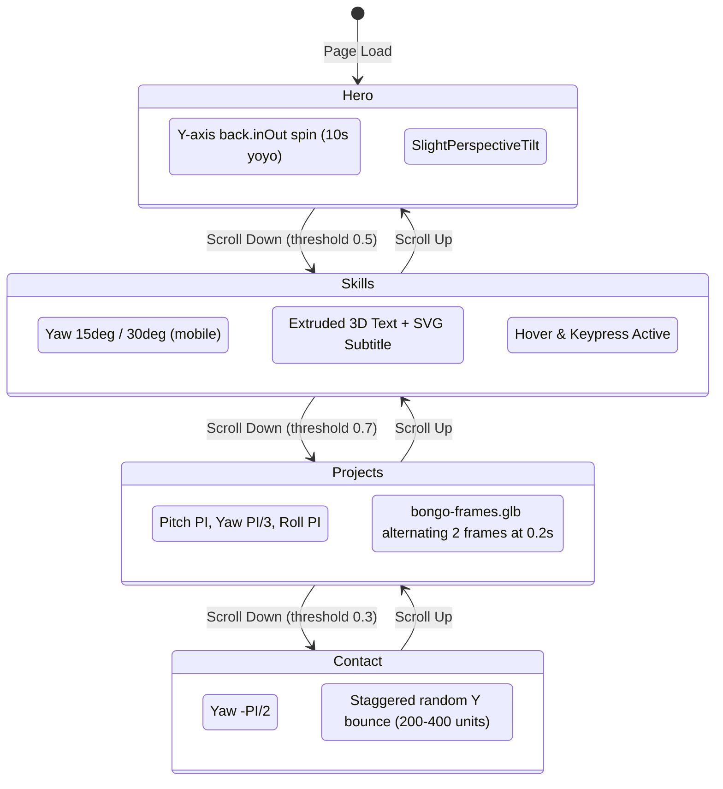

# Reference Analysis: Naresh-Khatri/3d-portfolio & nareshkhatri.dev

**Repository Analyzed:** [https://github.com/Naresh-Khatri/3d-portfolio](https://github.com/Naresh-Khatri/3d-portfolio)  
**Live Site Analyzed:** [https://nareshkhatri.dev](https://nareshkhatri.dev/)  
**Investigation Date:** October 2026  
**Auditor:** Antigravity Engineering

---

## 1. Executive Summary & Architectural Overview

The reference portfolio is a high-performance, single-page 3D interactive web application. Its central visual and interactive anchor is an interactive 3D mechanical keyboard rendered in WebGL that seamlessly orchestrates its position, rotation, scale, and behavior in direct synchrony with the user's scroll position down the page.

### Core Architecture Highlights:
1. **Framework & Runtime:** Next.js 16.2.2 (App Router) with React 19.2.4, TypeScript 5, and Tailwind CSS 3.4.1.
2. **3D Engine:** Powered by `@chibi3d/runtime` (v0.5.0) layered over `three` (v0.185.1). Chibi3D provides a declarative document/node/material graph with zero-runtime overhead, paired with Three.js math utilities (Euler, Quaternion, Vector3).
3. **Scroll & Motion Choreography:** GSAP 3.12.5 with `ScrollTrigger` and `@gsap/react`, paired with `lenis` (v1.1.6) for virtualized smooth scrolling and `motion` (Framer Motion v12.23.24) for UI micro-interactions.
4. **Resilience & Adaptive Graphics:** A custom frame-monitoring loop (`useAdaptiveGraphics`) continuously samples frame intervals, calculating the 95th percentile ($P_{95}$) render time. If frame drops are detected, it dynamically reduces anti-aliasing, turns off ambient occlusion (AO) and bloom, reduces device pixel ratio ($dpr$), and disables cast shadows. If WebGL fails or context is lost, an accessible HTML fallback seamlessly replaces the 3D scene.
5. **Accessibility First:** The 3D scene is complemented by an off-screen, live-announced ARIA mirror (`aria-live="polite"`), and an HTML fallback skill grid is maintained in the DOM for screen readers, search engines, and low-power devices.

---

## 2. Technology Stack & Dependencies Breakdown

| Layer | Package / Tool | Version | Role & Architectural Purpose |
| :--- | :--- | :--- | :--- |
| **Framework** | `next` | `16.2.2` | App router, SSR, code splitting, asset optimization. |
| **UI Library** | `react`, `react-dom` | `19.2.4` | Modern concurrent rendering, server & client component tree. |
| **3D Runtime** | `@chibi3d/runtime` | `0.5.0` | High-performance WebGL scene graph manager and renderer. |
| **Math / 3D Core** | `three`, `@types/three` | `0.185.1` | Quaternions, Euler angles, matrix calculations. |
| **Scroll Animation** | `gsap`, `@gsap/react` | `3.12.5` | Timeline scrubbing, scroll-driven pose interpolation, physics springs. |
| **Scroll Engine** | `lenis` | `1.1.6` | Smooth inertia scroll preventing jerky browser wheel ticks. |
| **Motion UI** | `motion` (Framer Motion) | `12.23.24` | Layout animations, responsive dialog transitions, hover states. |
| **Styling** | `tailwindcss`, `sass` | `3.4.1` | Utility styling, custom CSS custom properties, theme tokens. |
| **Dialogs / Drawers** | `vaul`, `@radix-ui/react-*` | `1.1.2` | Responsive drawer on mobile, modal dialogs on desktop. |
| **Audio** | Web Audio API | Native | Low-latency keypress and release mechanical switch sound synthesis. |
| **Typography** | `next/font` | Built-in | Space Grotesk (body/sans) & Unbounded (display/headings). |
| **Analytics/Presence** | `socket.io-client` | `4.8.3` | Multiplayer visitor cursor synchronization (optional add-on). |

---

## 3. Component Hierarchy & Data Flow

```
RootLayout (app/layout.tsx)
 ├── Providers (components/providers.tsx)
 │    ├── ThemeProvider (next-themes)
 │    └── PreloaderProvider (components/preloader/index.tsx)
 └── SiteFrame (components/site-frame.tsx)
      ├── Header (components/header/header.tsx)
      │    ├── NavigationLinks
      │    ├── ThemeToggle
      │    └── GitHubStars
      ├── Main (app/page.tsx)
      │    └── SmoothScroll (components/smooth-scroll.tsx)
      │         ├── AnimatedBackground (components/animated-background.tsx)
      │         │    └── SceneErrorBoundary
      │         │         └── KeyboardScene (components/keyboard/keyboard-scene.tsx)
      │         │              ├── SceneCanvas (@chibi3d/runtime)
      │         │              └── ARIA Live Announcement Mirror
      │         ├── HeroSection (components/sections/hero.tsx)
      │         ├── SkillsSection (components/sections/skills.tsx)
      │         ├── ExperienceSection (components/sections/experience.tsx)
      │         ├── ProjectsSection (components/sections/projects.tsx)
      │         │    └── ProjectCard -> ResponsiveDialog -> ScrollingPreview
      │         └── ContactSection (components/sections/contact.tsx)
      ├── Footer (components/footer/footer.tsx)
      └── AppOverlays (components/app-overlays.tsx)
           ├── Particles (components/Particles.tsx)
           ├── RemoteCursors (components/realtime/remote-cursors.tsx)
           ├── ElasticCursor (components/ui/ElasticCursor.tsx)
           ├── RadialMenu (components/radial-menu/index.tsx)
           └── MotionNudge (components/motion-nudge.tsx)
```

### Data Flow & Section Synchronization
1. The `KeyboardScene` renders in a `fixed inset-0` full-viewport WebGL canvas behind the HTML content (`canvas-overlay-mode`).
2. HTML sections (`#hero`, `#skills`, `#projects`, `#contact`) have large scroll heights (`h-screen`, `md:h-[150dvh]`).
3. As the user scrolls, `ScrollTrigger` instances in `createKeyboardMotion` detect which section is entering the active viewport threshold:
   - `skills`: `threshold: 0.5`
   - `projects`: `threshold: 0.7`
   - `contact`: `threshold: 0.3`
4. The motion controller updates the keyboard's global group transforms (target position, rotation, and scale) and triggers section-specific micro-animations (e.g., Cat typing in Projects, Keycap disassembly in Contact).

---

## 4. Deep Dive: 3D Keyboard Engineering Teardown

### 4.1 Asset Structure & Procedural 3x3 Geometry Slicing
The keyboard relies on a single compact GLB model: `public/assets/keyboard/keycaps.glb` (204 KB).
Instead of storing a monolithic keyboard model for every layout, the GLB contains:
- **Mesh `"0"`**: A single sculpted, high-detail mechanical keycap.
- **Meshes `"1"` through `"9"`**: A 3x3 segmented keyboard case.
  - Mesh 1: Top-left corner
  - Mesh 2: Top edge (stretchable along X)
  - Mesh 3: Top-right corner
  - Mesh 4: Left edge (stretchable along Z)
  - Mesh 5: Center base plate (stretchable along X and Z)
  - Mesh 6: Right edge (stretchable along Z)
  - Mesh 7: Bottom-left corner
  - Mesh 8: Bottom edge (stretchable along X)
  - Mesh 9: Bottom-right corner

#### Procedural Sizing Formula (`scene.ts`):
```typescript
const cols = Math.min(columns, skills.length);
const rows = Math.ceil(skills.length / cols);
const innerX = KIT.cutX + (cols - 6) * KIT.pitch / 2;
const innerZ = KIT.cutZ + (rows - 4) * KIT.pitch / 2;

// The 3x3 case slices scale center pieces while keeping corner bevels exact:
for (let z = 0; z < 3; z++) {
  for (let x = 0; x < 3; x++) {
    const sx = x === 1 ? innerX / KIT.cutX : 1;
    const sz = z === 1 ? innerZ / KIT.cutZ : 1;
    model(`Case ${x}:${z}`, String(1 + z * 3 + x), caseMaterial, layout,
      [(x - 1) * (innerX - KIT.cutX), 0, (z - 1) * (innerZ - KIT.cutZ)],
      [sx, 1, sz]
    );
  }
}
```
**Why this is brilliant:** Any number of skills (from 6 to 96) can be configured without ever re-exporting a 3D model. The corner fillets and bevels retain exact 1:1 scale, while the case mathematically expands to fit the keycap grid.

### 4.2 Coordinate System, Camera & Lighting
- **Camera:** Orthographic camera at `position: [-9, 9.6, 9]`, looking at `target: [0, 0.6, 0]`, with `fov: 36`.
  - Orthographic projection eliminates perspective distortion, giving the keyboard a crisp, technical CAD/isometric aesthetic.
- **Lighting:**
  - **Key Light:** Directional light at `[-6, 8, -3]` with `intensity: 2.8` and `castShadow: true`.
  - **Fill Light:** Directional light at `[4, 6, 6]` with `intensity: 0.12` and `castShadow: false`.
  - **Environment Preset:** `"product"` studio lighting with exposure `0.84`.

### 4.3 Keycap Textures & 3D Extruded Labels
- **Keycap Legends:** Individual skill logos (React, Python, TypeScript, etc.) are rendered as textured quads positioned at `[0, KIT.logoY, 0]` directly on top of each sculpted keycap mesh.
- **Floating 3D Title:** When a key is active, a 3D extruded title mesh (`geometry: { kind: "text3d" }`) renders above the keyboard with precomputed font bounding metrics (`heading-metrics.json`).
- **Dynamic Description Artwork:** Below the 3D title, an SVG image plane is dynamically generated on-the-fly (`descriptionArtwork`), rendered to a high-resolution data URI (`data:image/svg+xml,...`), and mapped onto a plane mesh to display a crisp description without loading heavy 3D glyph sets.

### 4.4 Section-by-Section Motion Choreography (`motion.ts`)



### 4.5 Physics & Interaction Handling (`input.ts` & `use-keyboard-sounds.ts`)
1. **Multi-Source Keypress State:** Keys maintain a set of pressing sources (`hover`, `pointer:<id>`, `key:<code>`). A key only releases when *all* sources release, preventing stuck keys during rapid pointer/keyboard multi-touch.
2. **Press Translation & Glow:**
   - Position moves down by `-KIT.keyHeight * 0.6` over `0.1s` with `easeInOut`.
   - Material emissive color switches from `#000000` to the skill's brand color with `emissiveIntensity: 0.7`.
3. **Web Audio Switch Feedback:**
   - Pre-fetches `/assets/keycap-sounds/press.mp3` and `release.mp3`.
   - AudioContext is automatically unlocked on first user interaction (`pointerdown` or `keydown`).
   - Plays with gain attenuation (`gain.gain.value = 0.4`) and automatic node cleanup (`onended`).

---

## 5. Performance Engineering & Adaptive Quality

The reference employs a proactive multi-tier performance strategy:

1. **Active Adaptive Frame Profiler (`use-adaptive-graphics.ts`):**
   - Monitors `requestAnimationFrame` delta times during active user interaction.
   - Computes rolling average and 95th percentile ($P_{95}$).
   - Adjusts between 4 quality tiers (`GRAPHICS_LEVELS`):
     - **Ultra:** DPR 2.0, soft shadows, AO, bloom, directional lighting.
     - **High:** DPR 1.5, hard shadows, no bloom, directional lighting.
     - **Medium:** DPR 1.0, shadows disabled, simplified shading.
     - **Low:** DPR 0.75, unlit / simple materials.
2. **Idle Freezing:** When no mouse or scroll activity occurs, the canvas tick loop idles to preserve mobile battery.
3. **Tab Visibility Throttling:** When `document.hidden` becomes true, audio contexts suspend, GSAP tweens pause, and WebGL renders halt.
4. **Context Loss Watchdog:** Catches `contextLost` WebGL events, releases memory, and transitions state to the accessible HTML fallback without breaking the page.

---

## 6. Licensing & Asset Attribution Verification

| Asset / Library | Origin / Creator | License | Attribution Requirement |
| :--- | :--- | :--- | :--- |
| `Naresh-Khatri/3d-portfolio` source code | Naresh Khatri | MIT License | Maintain copyright notice in repository and documentation. |
| `keycaps.glb` (Modular keyboard model) | Shipped with reference repo | MIT License | Permitted for public adaptation with attribution. |
| `bongo-frames.glb` (Bongo cat frames) | Shipped with reference repo | MIT License | Permitted for public adaptation with attribution. |
| Keycap sound effects (`press.mp3`, `release.mp3`) | FreeSound / Open asset | Creative Commons / Public Domain | Retain credit in asset credits. |
| SVGs in `/public/assets/keyboard/logos/` | SimpleIcons / Official logos | Various (Permissive/Trademark) | Fair use for skill identification. |
